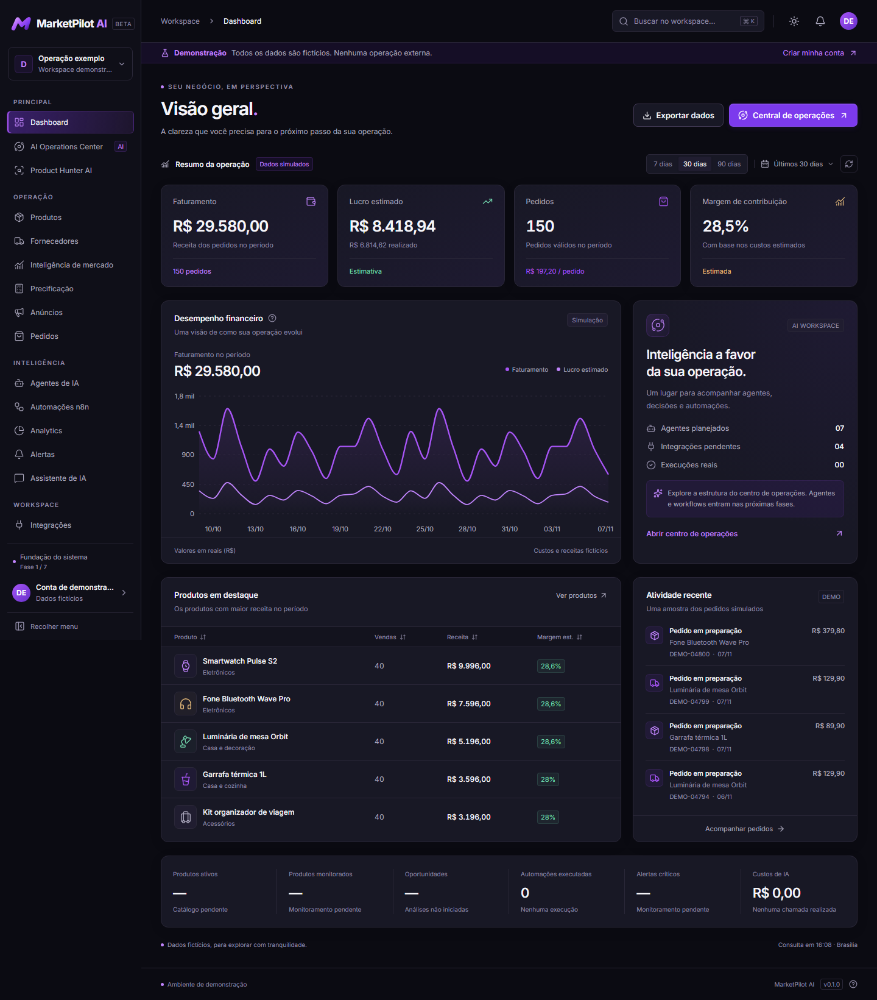

# MarketPilot AI

Plataforma para operações de dropshipping nacional, desenvolvida por fases. **A entrega atual é a Fase 1: fundação, autenticação e dashboard.** Os módulos comerciais e as integrações oficiais ainda não executam operações externas.



## Executar no Windows, Linux ou macOS

Requisitos: Node.js **22.12+** (validado com 24), npm e uma porta livre para a web (3000) e API (4000). Não são necessárias chaves externas para esta fase.

```powershell
npm ci
Copy-Item .env.example .env
npm run db:local
npm run db:generate
npm run db:migrate
npm run dev
```

No Linux/macOS, substitua `Copy-Item` por `cp`. `db:local` inicia um servidor **Prisma Postgres local de desenvolvimento**, sem Docker, com nome `marketpilot`. Confira a URL retornada pelo comando e ajuste `DATABASE_URL` se a porta padrão 51214 estiver ocupada. Dados locais são persistidos pela ferramenta Prisma, fora do diretório de código. Para parar: `npm run db:local:stop`.

- Demonstração: [localhost:3000/demo](http://localhost:3000/demo)
- Criar conta local: [localhost:3000/signup](http://localhost:3000/signup)
- Login: [localhost:3000/login](http://localhost:3000/login)
- Documentação REST: [localhost:4000/docs](http://localhost:4000/docs)
- Health do processo: `/health`; readiness com consulta ao banco: `/ready`.

Não há usuário ou senha padrão. Crie sua própria conta. Ela começa com indicadores zerados e um workspace isolado; os valores fictícios existem somente em `/demo`.

Para um PostgreSQL convencional, configure `DATABASE_URL` e execute a mesma migração. O arquivo `compose.dev.yaml` oferece apenas um banco local isolado, se Docker já estiver instalado. Esta fase não instala Docker nem acessa a VPS.

## Funcional nesta fase

- Next.js App Router, React e TypeScript estrito; API Fastify separada.
- Cadastro local habilitável, login/logout, scrypt, sessões opacas com expiração no PostgreSQL e cookie HttpOnly.
- Isolamento por workspace, papéis ADMIN/OPERATOR/VIEWER e alteração de nome somente por administrador.
- Auditoria persistente de cadastro, acesso, logout e configuração.
- Dashboard com períodos de 7/30/90 dias, gráfico Recharts, ranking ordenável TanStack Table e exportação CSV identificada.
- Tema escuro/claro, sidebar retrátil, navegação móvel, busca de páginas e atalho Ctrl/Cmd+K.
- Demonstração explicitamente identificada, sem persistência comercial nem operações externas.
- Navegação para as 18 áreas, com estado e fase prevista claramente indicados.
- Estrutura do AI Operations Center: agentes aguardando, progresso zero, workflow estático e painéis vazios de atividades, decisões e aprovações.
- Identidade oficial roxa, Inter empacotada localmente e ativos SVG para fundos claros/escuros, favicon e ícone.

O centro de operações **não executa IA ou workflows nesta fase**. As outras páginas comerciais apresentam sua etapa de implementação; não são módulos operacionais completos. A landing page pública permanece na Fase 6; seus ativos de marca já estão disponíveis.

## Verificação

Com PostgreSQL iniciado e migração aplicada:

```powershell
npm run lint
npm run typecheck
npm test
npm run test:integration
npm run build
npx playwright install chromium
npm run test:e2e
```

Os testes de integração usam dados únicos em `example.test` e removem apenas os workspaces criados pelo próprio teste. Os E2E criam uma conta local identificada por `e2e-...@example.test`. Use um banco de teste isolado para CI.

`npm run validate` executa geração do cliente, lint, tipos, testes, build e E2E em sequência. Não execute o build em paralelo com os E2E: a geração do cliente Prisma pode reiniciar a API em modo watch.

Builds: `apps/api/dist/index.mjs` e `apps/web/.next`. A API tem build ESM com esbuild; os contratos e cliente Prisma são incluídos no bundle, bibliotecas externas continuam dependências instaladas. A web oferece output standalone, mas empacotamento de produção e deploy ficam na Fase 7.

```powershell
npm run start -w @marketpilot/api
npm run start -w @marketpilot/web
```

Esses comandos usam a `.env` local. Em produção, `APP_ORIGIN` deve ser HTTPS, cookies são Secure e `ALLOW_REGISTRATION` deve ser false. Não use Prisma Postgres local de desenvolvimento em produção.

## Estrutura e próximos passos

```text
apps/web/               Interface Next.js e primitives no padrão shadcn/ui
apps/api/               REST, sessão, autorização e agregação
packages/contracts/     Contratos públicos Zod/TypeScript
packages/database/      Prisma, schema e migrações PostgreSQL
tests/                  Unitários, integração e E2E
docs/                   Arquitetura, identidade, fases e screenshots
```

- [Arquitetura e limites](docs/architecture.md)
- [Guia oficial da identidade](docs/design-system.md)
- [Estado da Fase 1 e preparação da Fase 2](docs/phase-1.md)
- [Ativos da marca](apps/web/public/brand)

Fase 2: produtos, fornecedores, histórico de catálogo e importação CSV/XML autorizada. Fase 3: precificação testada e agentes OpenAI. Fase 4: Redis/BullMQ, n8n e feed de eventos real. Fase 5: OAuth Mercado Livre, anúncios aprovados e pedidos. Fase 6: analytics, landing e demonstração expandida. Fase 7: segurança final, backups, Docker/Hostinger/Coolify e deploy isolado.

## Limitações antes do lançamento público

Cadastro aberto é uma opção explícita de desenvolvimento. Ainda faltam confirmação de e-mail, recuperação de senha, MFA, convites, retenção/expurgo de auditoria, gestão de usuários e procedimentos LGPD. O rate limit usa memória em uma réplica; Redis será exigido para múltiplas réplicas. Nenhuma credencial comercial é coletada nesta entrega. Segredos nunca devem ser adicionados a variáveis `NEXT_PUBLIC_*`.
