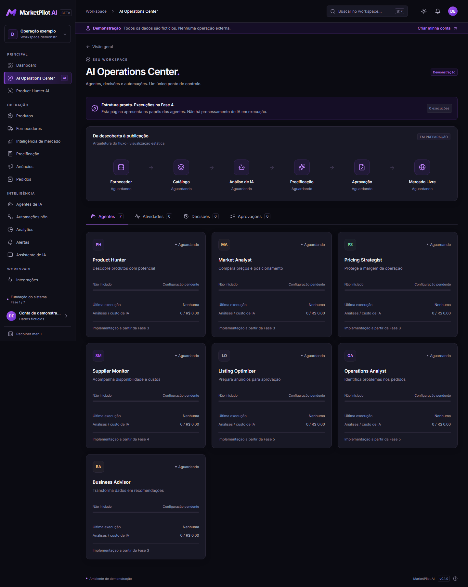
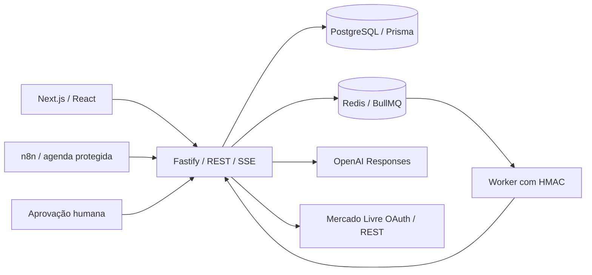

# MarketPilot AI

Plataforma SaaS de operações comerciais com catálogo rastreável, precificação determinística, agentes supervisionados e integrações oficiais configuráveis. Interface em português, Inter local e identidade roxa oficial, com temas escuro/claro.

Repositório oficial: [henrriquelealbranco/marketpilotai](https://github.com/henrriquelealbranco/marketpilotai). A branch principal é `main`; as alterações continuam neste projeto, sincronizadas com esse repositório.



As fases 1/2 foram preservadas. As fases 3–7 ampliam a aplicação existente. **O ambiente local não tem credenciais OpenAI/Mercado Livre/n8n, Redis nem Docker.** Análises por regras e módulos internos funcionam sem essas conexões. Adaptadores externos têm testes com transporte controlado; ativação e deploy remoto não foram realizados.

## Executar localmente

Requisitos: Node.js 22.12+ (validado com Node 24), npm, portas 3000/4000 e PostgreSQL. O banco de desenvolvimento pode ser iniciado sem Docker:

```powershell
git clone https://github.com/henrriquelealbranco/marketpilotai.git
cd marketpilotai
npm ci
Copy-Item .env.example .env
npm run db:local
npm run db:generate
npm run db:migrate
npm run dev
```

No Linux/macOS use `cp`. Ajuste `DATABASE_URL` conforme a porta retornada por `db:local`. O Prisma Postgres local mantém os dados fora do repositório. Para parar: `npm run db:local:stop`. Para PostgreSQL convencional configure a URL e aplique as migrações; `compose.dev.yaml` é opcional.

- [Apresentação pública](http://localhost:3000/)
- [Demonstração isolada](http://localhost:3000/demo)
- [Criar conta local](http://localhost:3000/signup) e [login](http://localhost:3000/login)
- [OpenAPI interativa](http://localhost:4000/docs)
- Saúde `/health`; banco `/ready`.

Não existe conta padrão. O cadastro cria uma operação vazia e isolada. `ALLOW_REGISTRATION` permite fechar novos cadastros; produção começa fechada. Não copie dados da demonstração para uma operação comercial.

## Funcionalidades

| Área                   | Comportamento                                                                                                                                                       |
| ---------------------- | ------------------------------------------------------------------------------------------------------------------------------------------------------------------- |
| Identidade e catálogo  | Sessão opaca HttpOnly, ADMIN/OPERATOR/VIEWER, workspace e auditoria; fornecedores/produtos, CSV/XML autorizado, versões, arquivo reversível e histórico de custos.  |
| Precificação           | Cálculos inteiros, taxas informadas, equilíbrio, preço mínimo/recomendado, lucro, margem, ROI, sensibilidade e cotações persistidas.                                |
| Agentes                | Sete especialidades, consultas restritas ao workspace. Regras ou OpenAI Responses configurado; histórico, evidências, revisão, duração, tokens e custos conhecidos. |
| Central de operações   | Feed SSE persistido, agentes, decisões, aprovações vinculadas ao conteúdo/versão e histórico de workflows.                                                          |
| Mercado                | Observações autorizadas, preços, atributos e fontes datadas; sem inventar demanda ou presumir busca geral do marketplace.                                           |
| Anúncios               | Rascunhos, cotação válida, revisão e execução aprovada. OAuth, publicação/descrição e atualização de preço/estoque por adaptador oficial.                           |
| Pedidos                | Registro manual e consulta autorizada, identificador único, custos conferidos/estimados, status e rastreamento; notificações e fila.                                |
| Automações             | Dez workflows JSON, handler de erros, execução interna ou BullMQ, idempotência, backoff e agenda por workspace habilitado.                                          |
| Analytics e assistente | Filtros 7/30/90, categorias/fornecedores, IA, CSV/PDF, histórico pessoal de perguntas e evidências.                                                                 |
| Demonstração           | Catálogo/pedidos fictícios, simulação acionada pelo visitante, decisões/aprovações locais e navegação completa, sem chamadas privadas ou externas.                  |

Pedidos importados sem custos completos **não são interpretados como lucro**. Lucro realizado exige entrega e custos confirmados. Custos OpenAI são estimados em USD quando tarifas são configuradas; valores desconhecidos são identificados. O score é triagem dos sinais disponíveis, não previsão de vendas.

## Arquitetura



Monorepo npm: `apps/web`, `apps/api`, `apps/worker`, `packages/contracts` e `packages/database`. O browser nunca recebe chaves. O demo não executa chamadas externas. n8n indisponível não impede autenticação, catálogo, precificação ou análises internas.

## Validação

Com banco ativo e migrações aplicadas:

```powershell
npm run validate
npm run format:check
npm audit
```

`validate` gera Prisma, valida a estrutura da infraestrutura, executa lint, TypeScript, testes unitários/integração, builds API/worker/web e Playwright. Instale Chromium com `npx playwright install chromium` na primeira execução. Testes usam contas `example.test`; integração limpa seus workspaces e E2E deixa apenas dados locais de teste identificáveis.

Docker/Compose, imagem n8n e restauração exigem ensaio próprio antes de uso comercial. Validação estrutural e HTTP controlado não substituem esse ensaio nem a homologação das permissões da conta Mercado Livre.

## Documentação

- [Fases 3–7 e limites](docs/phase-3-7.md)
- [Resultados da verificação](docs/verification.md)
- [Integrações e segurança](docs/integrations.md)
- [Coolify e backups](docs/deployment.md)
- [Arquitetura](docs/architecture.md), [design system](docs/design-system.md)
- [Fase 1](docs/phase-1.md), [Fase 2](docs/phase-2.md), [CSV/XML](docs/catalog-format.md)
- [Workflows e importação](workflows/README.md)

GitHub CI usa PostgreSQL isolado. Segredos, `.env`, backups, dados pessoais e cliente Prisma gerado não são versionados.
